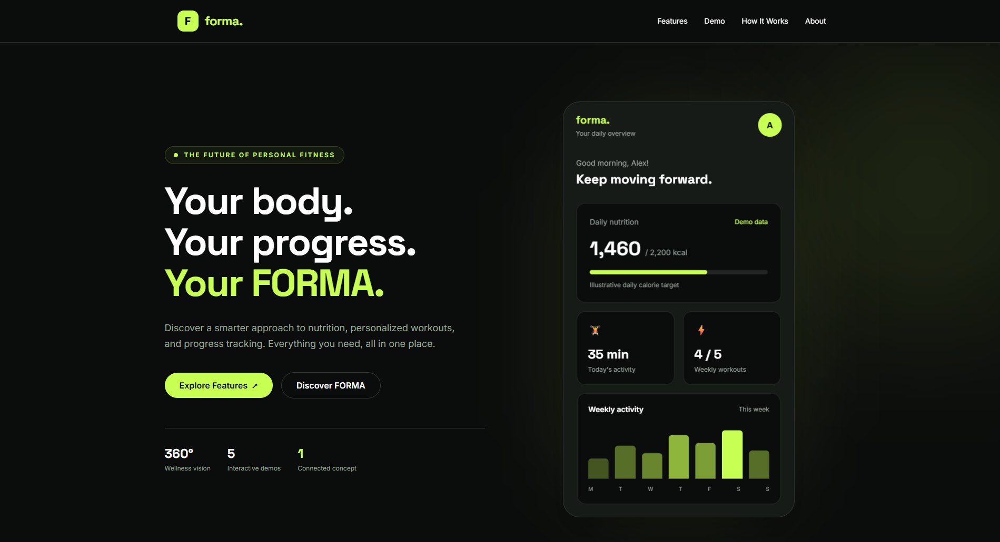

# FORMA

**Your Body. Your Progress.**


**Live Demo:** [FORMA on Render](YOUR_RENDER_URL)

**Source Code:** [GitHub Repository](https://github.com/chorus09/forma-landing)

### Application Preview




FORMA is an interactive fitness and nutrition web experience built as a backend-focused software engineering portfolio project.

It combines an ASP.NET Core backend with a responsive frontend and five interactive demonstrations.

> FORMA is a portfolio concept, not a production healthcare or nutrition service. All shopping and activity datasets are fictional.

## Features

- **Calorie Calculator** — Estimates BMR and daily energy expenditure using the Mifflin-St Jeor equation.
- **Body Progress** — Interactive before/after visual comparison.
- **Workout Planner** — Generates illustrative workout schedules based on goal, experience level and weekly frequency.
- **Progress Dashboard** — Displays fictional workout statistics and interactive analytics.
- **Product Comparison** — Compares sample grocery products, nutritional information and fictional retailer prices.

The landing page also includes GSAP animations, 3D hero interactions, responsive layouts, accessible navigation and SEO metadata.

## Technology Stack

| Layer | Technology |
| --- | --- |
| Backend | C#, ASP.NET Core 10 |
| Web framework | Razor Pages |
| Frontend | HTML, Tailwind CSS 4, JavaScript |
| Animations | GSAP, ScrollTrigger |
| Testing | xUnit, ASP.NET Core WebApplicationFactory |
| Deployment | .NET publish, Docker |
| Database | Not required |

## Architecture

```text
FORMA/
├── src/
│   └── Forma.Web/
│       ├── Models/
│       ├── Services/
│       ├── Pages/
│       ├── wwwroot/
│       └── Program.cs
├── tests/
│   └── Forma.Web.Tests/
├── FORMA.slnx
├── package.json
├── Dockerfile
└── README.md
```

The backend uses dependency injection and dedicated services for calculations, workout generation and demo data.

The frontend communicates with the backend through lightweight JSON APIs.

## API Endpoints

| Method | Endpoint | Description |
| --- | --- | --- |
| POST | `/api/calories` | Calculate estimated calorie needs |
| POST | `/api/workouts` | Generate an illustrative workout plan |
| GET | `/api/demo/dashboard` | Retrieve fictional training statistics |
| GET | `/api/demo/products` | Retrieve fictional product and price data |

### Example: Calorie Calculator

Request:

```json
{
  "age": 25,
  "weightKg": 75,
  "heightCm": 180,
  "sex": 0,
  "activityLevel": 2
}
```

The endpoint returns the calculated basal metabolic rate and estimated daily calories.

## Getting Started

### Requirements

- .NET 10 SDK
- Node.js and npm
- Git

### Install and Run

```bash
git clone https://github.com/chorus09/forma-landing.git
cd forma-landing

npm ci
npm run css:build

dotnet restore FORMA.slnx
dotnet run --project src/Forma.Web
```

Open the local URL displayed in the terminal.

### CSS Development

```bash
npm run css:watch
```

Run this in a separate terminal while developing frontend styles.

## Automated Testing

FORMA uses xUnit for service-level and HTTP integration tests.

Run all tests:

```bash
dotnet test FORMA.slnx
```

The test suite covers calorie calculations, input validation, workout planning, fictional demo data and HTTP endpoints.

At the completion of Commit #21, all 26 automated test cases passed.

## Production Build

```bash
npm ci
npm run css:build

dotnet publish src/Forma.Web/Forma.Web.csproj \
  -c Release \
  -o ./publish/forma
```

Run the published application from its output directory:

```bash
cd publish/forma
dotnet Forma.Web.dll
```

## Docker

Build:

```bash
docker build -t forma-web .
```

Run:

```bash
docker run --rm -p 8080:8080 forma-web
```

Then open `http://localhost:8080`.

The multi-stage Docker build compiles Tailwind CSS and publishes the ASP.NET Core application.

## Accessibility and Performance

The project includes:

- Keyboard-accessible navigation and visible focus states
- Skip-to-content navigation
- Reduced-motion support
- Responsive interactions
- SEO and social metadata
- Minified Tailwind CSS
- Deferred JavaScript loading
- ASP.NET Core response compression

## Project Limitations

FORMA is an educational demonstration. It does not currently include:

- User authentication
- A persistent database
- Real fitness tracking or personal photo storage
- Live product prices or retailer integrations
- Production medical or personalized fitness advice

## Author

Developed by [chorus09](https://github.com/chorus09).

Repository: https://github.com/chorus09/forma-landing
